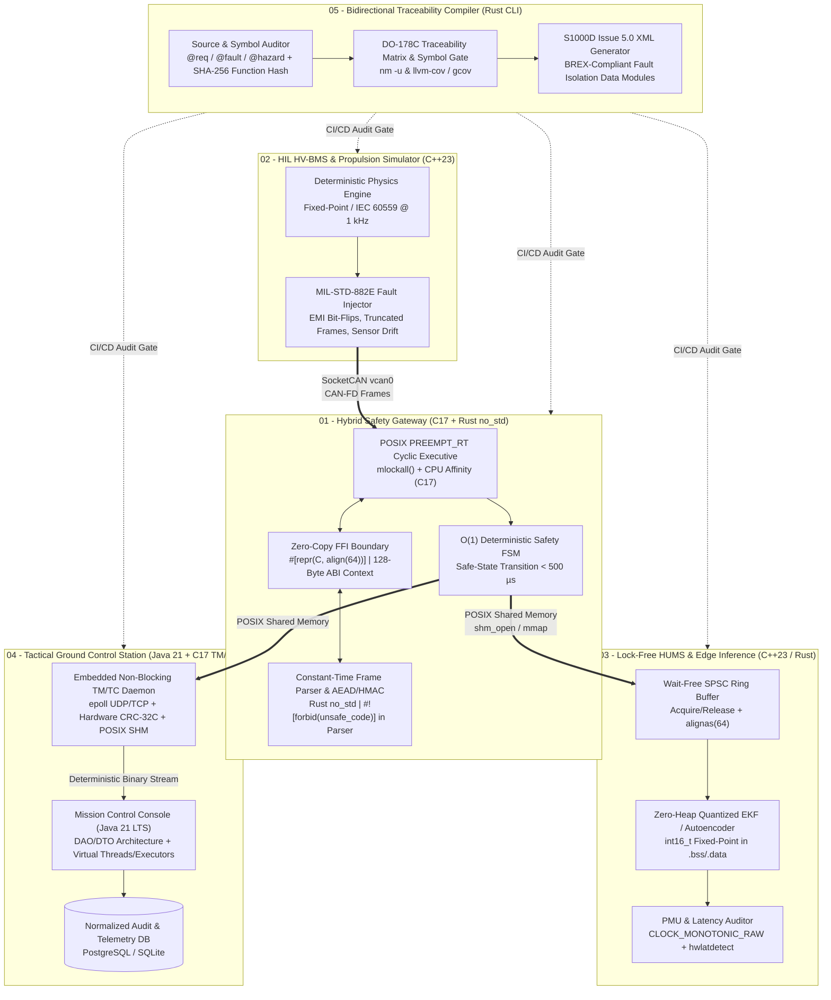

# AEGIS Critical Systems (`aegis-critical-systems`)

> **Deterministic Mixed-Language Architecture (C17 / C++23 / Rust `no_std` / Java 21) for Mission-Critical Propulsion Telemetry, HIL Fault Injection, and DO-178C $\leftrightarrow$ S1000D Traceability**

[](#)
[](#)
[](#)
[](#)
[](#)

---

## 1. Executive Summary & Architectural Thesis

Modern aerospace and defense engineering faces a structural bottleneck in **deterministic systems engineering, mixed-language safety architectures (`C17`/`C++23` + `Rust no_std`), embedded cybersecurity (`RTCA DO-326A` / `NIS2`), and bidirectional certification traceability (`DO-178C` / `MIL-STD-882E` / `S1000D`)**.

Instead of building five isolated repositories, **AEGIS Critical Systems** is architected as a **single, vertically integrated Hardware-in-the-Loop (HIL) and Telemetry Platform** composed of **5 tightly coupled subsystems**. Every subsystem enforces zero dynamic memory allocation after initialization (`malloc`/`free` forbidden in control loops), bounded Worst-Case Execution Time ($\text{WCET}$), and automated source-to-documentation traceability.



---

## 2. Integrated Subsystem Specifications & Engineering Refinements

### Subsystem 01: Critical Bus Gateway (`01-hybrid-can-gateway`)
* **Architectural Role:** Mixed-language (`C17` + `Rust no_std`) CAN-FD / MIL-STD-1553 gateway with `RTCA DO-326A` frame authentication.
* **Core Components:**
  * **Scheduling Core (`C17` / `MISRA C:2012`):** Static time-triggered cyclic executive running on Linux `PREEMPT_RT` with locked memory pages (`mlockall(MCL_CURRENT | MCL_FUTURE)`), `SCHED_FIFO` priority, and isolated CPU affinity.
  * **Safe Boundary (`Rust no_std`):** Zero-heap protocol parser and constant-time HMAC/AEAD validator. All parsing logic enforces `#![forbid(unsafe_code)]` and zero `core::panicking` symbols in the resulting static archive (`libaegis_parser.a`).
* **Critical Engineering Adjustments:**
  * **128-Byte Cache-Aligned ABI Contract:** A Linux `<linux/can.h>` `struct canfd_frame` is **72 bytes** (8B header + 64B payload). To prevent L1d false sharing and partial cacheline splits across the FFI boundary, the shared context (`t_aegis_frame_ctx`) is explicitly padded to **128 bytes** (exactly two 64-byte cache lines: 72B frame + 56B monotonic timestamps, HMAC tag, and status flags) and verified at compile time via `_Static_assert(sizeof(t_aegis_frame_ctx) == 128, "ABI size mismatch")`.
  * **MC/DC & Object Code Verification:** Boolean decisions in the safety path are decomposed into flat, non-jump-table predicates to prevent source-to-object code coverage discrepancies (`DO-178C DAL-A`), audited via `llvm-cov`/`gcov` and `objdump -d`.

### Subsystem 02: HV-BMS & Propulsion HIL Digital Twin (`02-hil-hvbms-sim`)
* **Architectural Role:** High-Voltage Battery Management System (HV-BMS) and fuel-injection physical plant simulator with `MIL-STD-882E` hazard injection.
* **Core Components:**
  * **Deterministic Plant Model (`C++23`):** Simulates voltage sag under peak discharge, cell thermal runaway derivatives, and injector rail pressure at $1\ \text{kHz}$ over `vcan0` (`SocketCAN`).
  * **Chaos & Fault Injector (`MIL-STD-882E`):** Injects EMI-induced spurious frames, bit-flips, sensor drift, bus saturation, and heartbeat timeouts.
* **Critical Engineering Adjustments:**
  * **Zero-Indirection $\mathcal{O}(1)$ Safety FSM:** Instead of `std::visit` over `std::variant` (which can emit function-pointer dispatch tables flagged by `MISRA C++:2023` WCET rules), the supervisor state machine uses a 2D `constexpr` transition table indexed by `[CurrentState][Event]` with strict `-Wswitch-enum` enforcement, guaranteeing transition to `SAFE_STATE` (HV contactor open) in $< 500\ \mu\text{s}$.

### Subsystem 03: Lock-Free HUMS & Edge Anomaly Engine (`03-lockfree-hums`)
* **Architectural Role:** Health and Usage Monitoring System with empirical $\text{WCET}$ guarantees under extreme host load.
* **Core Components:**
  * **Wait-Free Ingestion:** Single-Producer Single-Consumer (SPSC) ring buffer using explicit memory barriers (`std::memory_order_acquire` / `std::memory_order_release`) and `alignas(64)` slot alignment.
  * **Zero-Heap Deterministic Inference:** Extended Kalman Filter (EKF) and `int16_t` fixed-point (`Q15`) autoencoder operating strictly on pre-allocated static buffers in `.bss`/`.data`.
  * **Hardware Latency Harness:** Automated benchmark pairing `stress-ng` with `clock_gettime(CLOCK_MONOTONIC_RAW)`, `perf stat` (L1d/LLC misses, branch mispredictions), and `hwlatdetect` to isolate UEFI/BIOS System Management Interrupts (SMI).
* **Critical Engineering Adjustments:**
  * **Post-Init Allocation Trap:** Integration tests link a custom allocator guard (backed by `nm -u` symbol verification and `Valgrind`) that raises `SIGABRT` if any heap allocation occurs after `hums_init()`.

### Subsystem 04: Tactical Ground Control Station & TM/TC Node (`04-tactical-gcs`)
* **Architectural Role:** End-to-end mission telemetry and command pipeline bridging embedded POSIX systems (`42`) with enterprise multi-tier architecture (`DAM`).
* **Core Components:**
  * **Embedded Segment (`C17` / `POSIX.1-2017`):** Non-blocking `epoll` UDP/TCP telemetry daemon reading from POSIX shared memory (`shm_open`/`mmap`), framing packets with hardware-accelerated CRC-32C.
  * **Ground Segment (`Java 21 LTS` + `SQL`):** Multi-layered mission console applying strict `DAO`/`DTO`/Service separation, deterministic resource lifecycle (`try-with-resources`), thread-safe concurrency (`ExecutorService`), and normalized SQL persistence for DTC/hazard auditing.
  * **Qualifiable DevSecOps Pipeline:** GitHub Actions gating merges on `clang-tidy`, `cppcheck`, `cargo clippy --pedantic`, `ASan`/`UBSan`/`TSan`, `Valgrind` (zero memory/FD leaks), and cyclomatic complexity $\le 10$.

### Subsystem 05: DO-178C $\leftrightarrow$ S1000D Traceability Compiler (`05-trace-s1000d-cli`)
* **Architectural Role:** Automated verification and Integrated Logistics Support (ILS) compiler bridging software engineering (`DO-178C`) and defense technical publications (`S1000D Issue 5.0`).
* **Core Components:**
  * **Traceability Scanner (`Rust` CLI):** Parses structured source annotations (`// @req SRS-BMS-042`, `// @fault DTC-0x104: HV_ISOLATION_LOSS`, `// @hazard MIL-882E-CAT-I`) across `.c`, `.h`, `.cpp`, and `.rs` files.
  * **AST/Body Integrity Hashing:** Computes a `SHA-256` digest of each traced function body; if implementation logic changes without updating its verification record, the CI build fails.
* **Critical Engineering Adjustments:**
  * **Scoped S1000D BREX Profile:** Rather than implementing the entire S1000D Issue 5.0 schema catalog, the generator enforces a strict Business Rules Exchange (**BREX**) subset targeting `fault.xsd` (*Fault Isolation Data Modules*) and `descript.xsd`, automatically compiling firmware DTC catalogs and precondition guards into valid S1000D XML trees.

---

## 3. Architecture, Technical Debt & Risk Mitigation Matrix

| Subsystem | Time / Space Complexity | Target Standards | Portfolio Environment Technical Debt | Structural Risk & Engineering Mitigation |
| :--- | :--- | :--- | :--- | :--- |
| **01. Hybrid Gateway (`C17` + `Rust no_std`)** | **Time:** $\mathcal{O}(1)$ per frame<br>**Space:** $\mathcal{O}(1)$ (100% static) | `DO-178C` (DAL-A/B)<br>`MISRA C:2012`<br>`RTCA DO-326A` | Open-source `clang` / `rustc` toolchain without commercial `DO-330` qualification kit (e.g., Ferrocene / GNAT Pro). | **Risk:** Source-to-Object Code (`EOC`) coverage discrepancy.<br>**Mitigation:** Flat predicate decomposition + automated `objdump -d` and `nm -u` symbol auditing (zero `core::panicking`). |
| **02. HIL HV-BMS (`C++23`)** | **Time:** $\mathcal{O}(1)$ state transition<br>**Space:** $\mathcal{O}(1)$ | `MIL-STD-882E`<br>`ISO 26262`<br>`MISRA C++:2023` | Virtual bus (`vcan0`) in Linux kernel instead of physical CAN-FD transceivers with bit-level electrical arbitration. | **Risk:** Local sk_buff stack hides Layer-1/2 physical collisions.<br>**Mitigation:** Explicit arbitration delay and bit-stuffing jitter model in the simulator clock + 2D `constexpr` FSM table. |
| **03. Lock-Free HUMS (`C++23` / `Rust`)** | **Time:** $\mathcal{O}(N)$ bounded ($N$ fixed weights)<br>**Space:** $\mathcal{O}(1)$ (zero heap) | `POSIX.1b` (Real-Time)<br>`IEEE 754` / Fixed-Point `Q15` | Execution on commercial x86_64 SMP hardware with non-maskable UEFI/BIOS System Management Interrupts (`SMI`). | **Risk:** Sporadic latency spikes ($\ge 50\ \mu\text{s}$) induced by firmware.<br>**Mitigation:** Correlate latency histograms with `hwlatdetect` and PMU counters (`perf stat`) to isolate hardware-induced jitter. |
| **04. Tactical GCS (`Java 21` + `C17`)** | **Time:** $\mathcal{O}(1)$ in C node; $\mathcal{O}(\log N)$ in GCS indexing | `STANAG 4586` (conceptual)<br>`POSIX.1-2017` | Ground station GUI/JVM operates in a non-deterministic garbage-collected domain. | **Risk:** GC pauses in ground visualization.<br>**Mitigation:** Strict architectural decoupling: safety and control loops reside 100% in the embedded `C17` node over `shm_open`. |
| **05. Trace Compiler (`DO-178C` $\leftrightarrow$ `S1000D`)** | **Time:** $\mathcal{O}(V + E)$ over trace graph<br>**Space:** $\mathcal{O}(V)$ | `DO-178C`<br>`S1000D Issue 5.0`<br>`MIL-STD-40051` | Lexical/structural block parser in Phase 1 instead of full `LLVM LibTooling` frontend. | **Risk:** Silent drift between code modifications and requirement tags.<br>**Mitigation:** `SHA-256` normalized function-body fingerprinting + scoped S1000D `fault.xsd` BREX validation. |

---

## 4. Repository Structure & Execution Roadmap

### Target Monorepo Layout
```text
aegis-critical-systems/
├── .github/workflows/ci.yml         # Automated CI (audit + sanitizers + gcov + xmllint)
├── README.md
├── Makefile                         # Master build, audit, sanitizer, and coverage orchestrator
├── CMakeLists.txt                   # C17 / C++23 strict toolchain configuration
├── Cargo.toml                       # Rust workspace (aegis-parser + aegis-trace)
├── requirements/                    # Low-Level Requirements (SRS YAML + trace.lock)
├── scripts/                         # vcan0 setup & multi-process E2E pipeline verification
├── 01-hybrid-can-gateway/           # C17 PREEMPT_RT cyclic executive + Rust no_std FFI
├── 02-hil-hvbms-sim/                # C++23 HV-BMS physics engine + MIL-STD-882E injector
├── 03-lockfree-hums/                # Wait-free SPSC ring buffer + Q15 EKF + malloc trap
├── 04-tactical-gcs/                 # C17 epoll TM/TC daemon + Java 21 GCS console (SQLite)
└── 05-trace-s1000d-cli/             # DO-178C traceability & S1000D XML compiler
```

### Completed Execution Roadmap

- [x] **Phase 0 — Monorepo & Toolchain Hardening:**
  - Initialized directory hierarchy, root `Makefile`, `CMakeLists.txt`, and `Cargo.toml` workspace.
  - Enforced strict compiler flags (`-Wall -Wextra -Werror -Wpedantic -Wconversion -Wsign-conversion -Wshadow -fno-exceptions -fno-rtti`) and `clippy::pedantic` + `unwrap_used`/`expect_used`/`panic` denial.
  - Configured `vcan0` virtual CAN-FD interface script (`scripts/setup_vcan.sh`).
- [x] **Phase 1 — Foundation: Traceability Gatekeeper (`05-trace-s1000d-cli`):**
  - Defined Low-Level Requirements (`requirements/SRS-GW-001.yaml`, `SRS-HIL-001.yaml`, `SRS-HUMS-001.yaml`, `SRS-GCS-001.yaml`).
  - Implemented zero-dependency Rust CLI scanner for `@req`, `@fault`, and `@hazard` across `.c`, `.h`, `.cpp`, `.hpp`, `.rs`, and `.java` with FIPS 180-4 `SHA-256` function fingerprinting, orphan detection, `trace.lock` drift gate, and dynamic S1000D `fault.xsd` XML emission.
- [x] **Phase 2 — Core Safety Loop (`01-hybrid-can-gateway` + `02-hil-hvbms-sim`):**
  - Defined 128-byte cache-aligned FFI ABI (`aegis_frame_abi.h`) and 64-byte POSIX SHM snapshot (`aegis_shm_bus.h`).
  - Implemented zero-heap `Rust no_std` frame parser + constant-time HMAC-SHA256 (`libaegis_parser.a`) verified via `nm -u` with zero `core::panicking` symbols.
  - Implemented `C17` `PREEMPT_RT` cyclic executive with `RTCA DO-326A` monotonic anti-replay (`DTC-0x106`) and `C++23` `constexpr` 2D safety FSM (`< 500 µs` transition).
- [x] **Phase 3 — Lock-Free Telemetry & Tactical GCS (`03-lockfree-hums` + `04-tactical-gcs`):**
  - Built wait-free `alignas(64)` SPSC queue over POSIX SHM and `Q15` fixed-point anomaly filter with `--wrap=malloc` post-init abort trap.
  - Built `C17` `epoll` TM/TC daemon (hardware SSE4.2 Castagnoli CRC-32C) and `Java 21 LTS` Tactical GCS console (`DAO`/`DTO`, Virtual Threads, parameterized SQLite persistence).
- [x] **Phase 4 — System Integration, Sanitizers & CI:**
  - Verified multi-process E2E pipeline (`scripts/test_e2e_pipeline.sh`), `ASan`/`UBSan`/`TSan` (`make sanitizers`), `gcov` coverage (`make coverage`), `xmllint`, and GitHub Actions CI.

---

## 5. Build, Verification & Measured Engineering Evidence

```bash
# Full qualification audit (C17/C++23/Rust/Java build, CTest, Cargo test, Clippy,
# E2E pipeline, Valgrind leak/FD check, nm -u panic-free gate, trace.lock & xmllint)
make audit

# AddressSanitizer, UndefinedBehaviorSanitizer & ThreadSanitizer (SPSC lock-free ring)
make sanitizers

# Line coverage extraction via gcov
make coverage

# Optional: bring up SocketCAN virtual CAN-FD bus (requires sudo)
./scripts/setup_vcan.sh vcan0
```

| Verification Metric | Observed Result |
| :--- | :--- |
| **C17 / C++23 Test Suite (`ctest`)** | `6/6` passed (`abi_contract`, `rust_nostd_ffi`, `gateway_cyclic_exec`, `hil_fsm_closed_loop`, `hums_lockfree`, `tmtc_epoll_crc32c`) |
| **Rust & Java 21 Suites** | `7/7` Cargo tests passed (`aegis-parser` + `aegis-trace`); `TacticalGcsTest` passed (`CRC-32C 0xE3069283` + SQLite + TCP) |
| **Memory & FD Safety (`Valgrind` + `--wrap=malloc`)** | `0 errors`, `0 bytes` leaked across all 6 C/C++ test binaries; zero post-init heap allocations on HUMS hot path |
| **Sanitizers (`ASan` + `UBSan` + `TSan`)** | `6/6` `ASan/UBSan` passed; `test_lockfree_hums` passed under `TSan` with zero data races |
| **HUMS SPSC + Q15 Latency (`CLOCK_MONOTONIC_RAW`, N=10,000)** | `p50 = 48–51 ns`, `p99 = 52–95 ns` (zero dynamic allocation) |
| **Release ELF Footprint (`size`)** | `aegis_gateway_node`: `11,701 B` `.text` \| `aegis_hil_sim`: `9,518 B` `.text` \| `aegis_tmtc_daemon`: `13,164 B` `.text` |
| **DO-178C / S1000D Traceability (`aegis-trace`)** | `14/14` SRS requirements verified across `16` source links (`trace.lock` + `xmllint --noout` clean) |
